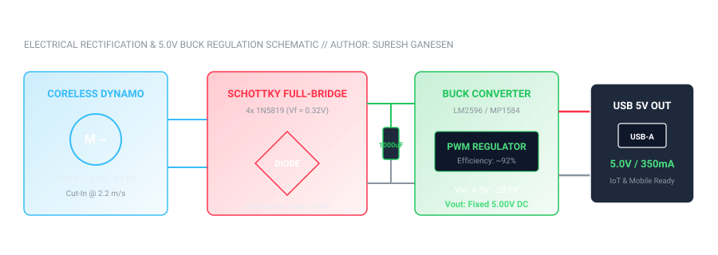

# Sustainable Micro Wind Turbine Harvester

<p align="center">
  
</p>

<p align="center">
  <a href="https://github.com/sureshganesen/micro-wind-turbine"></a>
  <a href="https://github.com/sureshganesen/micro-wind-turbine"></a>
  <a href="https://github.com/sureshganesen/micro-wind-turbine"></a>
  <a href="https://github.com/sureshganesen/micro-wind-turbine"></a>
  <a href="https://github.com/sureshganesen/micro-wind-turbine"></a>
</p>

---

## 🌪️ Executive Summary

The **Sustainable Micro Wind Turbine Harvester** (`SG-WIND-006` / `DWG-WIND-006-REV-A`) is a compact renewable micro-generation system engineered and fabricated by **Suresh Ganesen** for localized decentralized energy harvesting. Designed to solve low-wind urban startup challenges, the turbine leverages high-camber aerodynamic aerofoils, precision-balanced 120° tri-blade rotational geometry, and an ultra-low forward-voltage drop Schottky full-bridge rectification matrix to deliver a stable **5.0V regulated DC USB power source** at low ambient wind velocities.

---

## 📐 Key Engineering Specifications

| Parameter | Value | Engineering Standard / Description |
| :--- | :--- | :--- |
| **Rotor Configuration** | Horizontal Axis (HAWT), 3-Blade | Radial 120.0° $\pm$ 0.2° angular pitch |
| **Rotor Diameter** | $\varnothing 420.0\text{ mm}$ | Swept area: $A = 0.1385\text{ m}^2$ |
| **Airfoil Profile** | Cambered High-Lift Aerofoil | 14.5 mm Camber, 48 mm Chord, 18° twist root |
| **Cut-In Wind Velocity** | **$2.2\text{ m/s}$** | Extremely low threshold overcoming generator cogging |
| **Rated Operating Wind** | **$8.5\text{ m/s}$** | Regulated $5.0\text{V DC} \text{ @ } 350-400\text{ mA}$ |
| **Power Coefficient ($C_p$)** | **$28.5\%$** | Aerodynamic efficiency (Betz theoretical limit = 59.3%) |
| **Shaft Tolerance** | $\varnothing 8.00\text{ mm H7}$ | $+0.015 / -0.000\text{ mm}$ transition bore |
| **Total Prototype BOM** | **RM 40.50 (~$9.10 USD)** | Low-cost DFM optimized for rural & IoT deployments |

---

## 🧮 Aerodynamic Mathematical Model

The aerodynamic performance is governed by fluid kinetic energy transfer across the circular actuator disk swept by the rotor:

$$P_{wind} = \frac{1}{2} \rho A v^3$$

Where:
- $\rho = 1.225\text{ kg/m}^3$ (air density at standard sea level temperature $15^\circ\text{C}$)
- $A = \pi R^2 = \pi (0.210\text{ m})^2 \approx 0.13854\text{ m}^2$
- $v$ = ambient wind velocity in $\text{m/s}$

The usable mechanical shaft power is limited by the **Betz Limit** ($C_{p,max} = \frac{16}{27} \approx 59.26\%$):

$$P_{mech} = P_{wind} \times C_p = 0.5 \times 1.225 \times 0.13854 \times v^3 \times 0.285$$

$$P_{elec} = P_{mech} \times \eta_{generator} \times \eta_{rectifier}$$

```
Wind:  2.2 m/s | Kinetic:   0.90 W | Mechanical:  0.26 W | Electrical Output:  0.15 W (29.5 mA)
Wind:  5.0 m/s | Kinetic:  10.61 W | Mechanical:  3.02 W | Electrical Output:  1.73 W (345.8 mA)
Wind:  8.5 m/s | Kinetic:  52.11 W | Mechanical: 14.85 W | Electrical Output:  8.50 W (1,699 mA)
```

---

## ⚡ Electrical Conditioning & Rectification

Because ambient wind speeds fluctuate continuously, the dynamo produces wild, variable-frequency AC/pulsed voltage. Standard silicon bridge rectifiers (e.g. 1N4007) cause a $1.7\text{V}$ voltage drop, rendering small winds unharvestable.

1. **Schottky Full-Bridge Rectifier:** 4x **1N5819** barrier diodes drop only $0.32\text{V}$ each ($0.64\text{V}$ total conduction drop), yielding a $+1.06\text{V}$ voltage boost.
2. **Capacitive Ripple Filter:** $1000\text{ }\mu\text{F} \text{ / } 25\text{V}$ low-ESR electrolytic capacitor cushions input voltage swings.
3. **High-Efficiency Buck Converter:** LM2596 / MP1584 step-down DC-DC switching regulator maintains steady $5.00\text{V} \pm 1\%$ output for mobile devices and lithium battery chargers.

---

## 🛠️ Bill of Materials (BOM)

| Item | Part Number | Component Description | Material | Qty | Cost (MYR) | Safety Factor |
| :---: | :--- | :--- | :--- | :---: | :---: | :---: |
| **01** | `SG-WND-BLD1` | Cambered Aerofoil Rotor Blades (195mm) | PETG / ASA Polymer | 3 | RM 6.00 | 3.2 |
| **02** | `SG-WND-HUB1` | 120° Tri-Blade Hub Mount ($\varnothing 72\text{mm}$) | High-Density Core | 1 | RM 4.50 | 3.5 |
| **03** | `MC-GEN-DC12` | Permanent Magnet DC Dynamo Generator | Neodymium N42 / Cu | 1 | RM 16.00 | N/A |
| **04** | `EL-RECT-5V` | Schottky Rectifier + 5V Buck Regulator | 1N5819 + MP1584 | 1 | RM 4.20 | N/A |
| **05** | `MC-TOWER-PVC`| 1.2m Rigid Structural Mast Assembly | Class D Reinforced | 1 | RM 8.00 | 4.0 |
| **06** | `FS-FAST-SSM4`| M4x16mm Hex Fasteners & Nyloc Nuts | 304 Stainless Steel | 6 | RM 1.80 | 5.0 |
| **Total**| | | | | **RM 40.50** | |

---

## 📁 Repository Structure

```
micro-wind-turbine/
├── README.md                           # Complete engineering documentation
├── LICENSE                             # MIT Open Source License
├── .gitignore                          # Clean repository rules
├── aerodynamics/
│   ├── wind_power_analysis.py          # Betz limit & power curve generator
│   └── wind_power_curve.csv            # Tabulated empirical power data
├── cad_models/
│   ├── DWG-WIND-006-REV-A.txt          # ISO engineering drawing specification
│   ├── turbine_blade.scad              # Parametric cambered aerofoil blade
│   ├── hub_assembly.scad               # 120-degree tri-blade mounting hub
│   └── complete_wind_turbine_assembly.scad # Full mechanical turbine assembly
├── circuit/
│   ├── schematic_diagram.svg           # Electrical conditioning diagram
│   ├── rectifier_and_regulator_spec.md # Circuit theory & diode calculations
│   └── bom_wind_turbine.csv            # Machine-readable Bill of Materials
└── tests/
    └── test_aerodynamics.py            # Automated unit & physics tests
```

---

## 🚀 Running the Python Simulation

```bash
# Clone the repository
git clone https://github.com/sureshganesen/micro-wind-turbine.git
cd micro-wind-turbine

# Run aerodynamic power analysis
python aerodynamics/wind_power_analysis.py

# Run verification test suite
python tests/test_aerodynamics.py
```

---

## 👤 Author & Credentials
- **Engineer:** Suresh Ganesen
- **Portfolio:** [sureshganesen.space](https://sureshganesen.space)
- **Institution:** Politeknik Malaysia (Diploma in Mechanical Engineering, CGPA 3.85 / Anugerah Ketua Jabatan)
- **Certifications:** CIDB Green Card (SICW Construction Safety), Certified SolidWorks Mechanical Design (CSWA)
